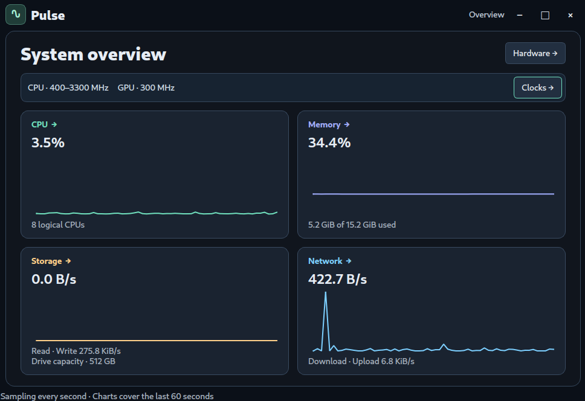
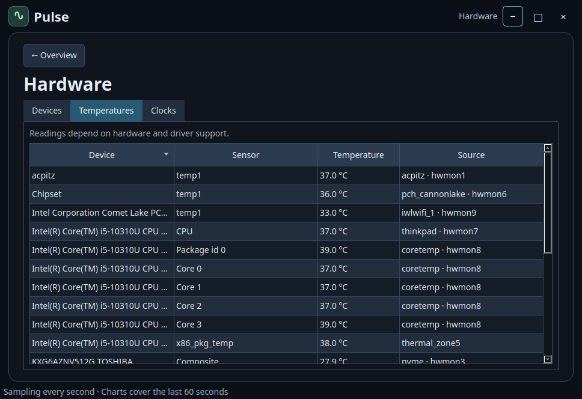

# Pulse
<!-- made by Péter Noé -->

Magyar · [English](README.md)

A Pulse egy asztali rendszerfigyelő Windowsra és Linuxra. A főképernyő mutatja a rendszer üzemidejét, a CPU és a RAM használatát, a lemezműveleteket és a hálózati forgalmat. A grafikonokon az utolsó egy perc látszik.



## Indítás forrásból

Python 3.12 vagy újabb kell hozzá. A parancsokat a projekt mappájában futtasd.

**Linux**

```bash
python3 -m venv .venv
.venv/bin/python -m pip install -e .
.venv/bin/python -m pulse
```

**Windows**

```powershell
py -3 -m venv .venv
.venv\Scripts\python.exe -m pip install -e .
.venv\Scripts\python.exe -m pulse
```

### Linux a rendszer PyQt5 csomagjával

Ha a rendszer Pythonjához már telepítve van a PyQt5 és a psutil, a Pulse a PySide6 letöltése nélkül is elindítható.

```bash
python3 -m venv --system-site-packages .venv
PYTHONPATH=src .venv/bin/python -m pulse
```

## Mit mutat az app?

| Nézet | Adatok |
| --- | --- |
| **CPU** | Processzortípus, logikai magonkénti terhelés és rendezhető folyamatlista. A listában név vagy PID alapján kereshetsz. A folyamat CPU-használata a teljes CPU-kapacitás százalékában látszik. |
| **Memory** | RAM- és swaphasználat, a folyamatok memóriája (RSS), valamint a kiolvasható RAM-modulok típusa, DDR-generációja, kapacitása és sebessége. |
| **Storage** | Olvasási és írási sebesség, meghajtótípusok, kapacitás GB-ban vagy TB-ban és a csatolt kötetek foglaltsága. |
| **Network** | Le- és feltöltési sebesség, valamint az összes küldött és fogadott adat hálózati interfészenként. |
| **Hardware** | Felismert eszközök, például a GPU, az alaplap, a BIOS és a hálózati adapterek. A **Temperatures** fülön a hőfok mellett az eszköz és a szenzor neve is látszik. |
| **Clocks** | CPU- és GPU-órajelek MHz-ben. A RAM sebessége MT/s-ban jelenik meg, a firmware által közölt beállított vagy névleges érték alapján. |



## Mikor jelennek meg az adatok?

- A lemez- és hálózati sebességhez két mérés kell. A kötőjel vagy az **Unavailable** azt jelzi, hogy az app nem kapott adatot.
- Linuxon a meghajtóadatokat az `lsblk`, a RAM-modulok adatait a `dmidecode` adja. A rendszer korlátozhatja a moduladatok olvasását. A CAS-késleltetés (CL) nem érhető el.
- Linuxon a CPU órajele logikai magonként jelenik meg, ha kiolvasható. Windowson az érték névleges is lehet. A GPU adatai az illesztőprogramtól függenek, az NVIDIA-adatokhoz az `nvidia-smi` kell.
