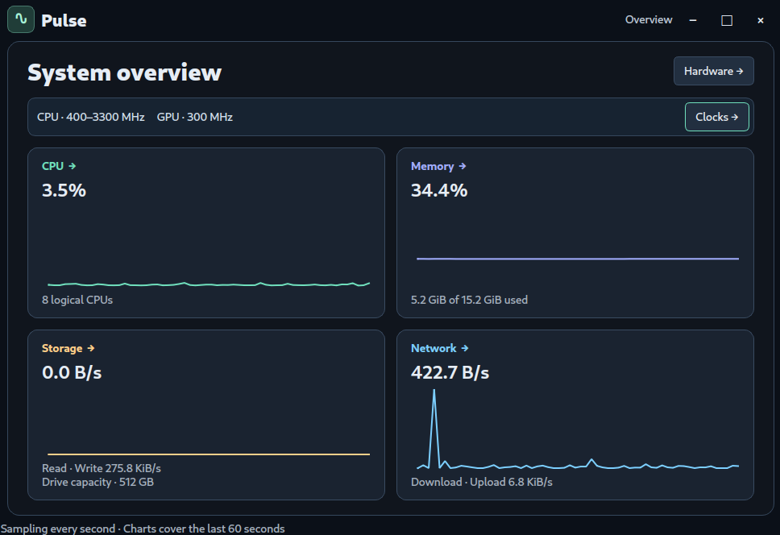
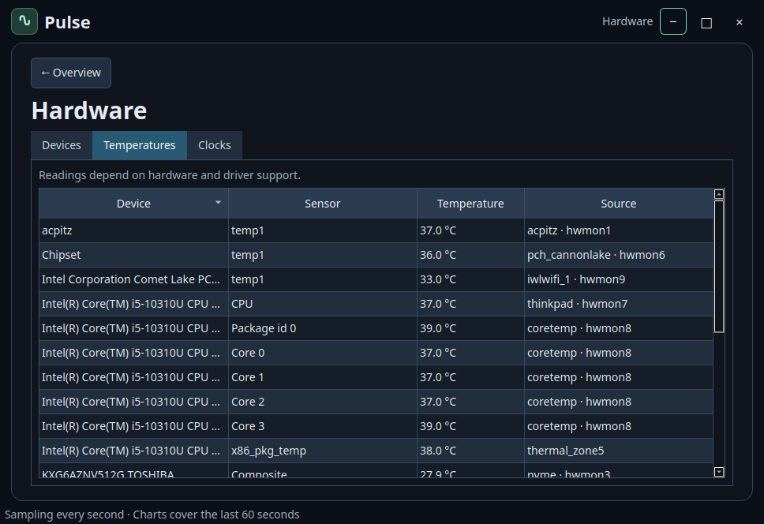

# Pulse
<!-- Készítette Péter Noé -->

[Magyar](README.hu.md) · English

Pulse is a desktop system monitor for Windows and Linux. The dashboard shows system uptime, CPU and RAM usage, disk activity, and network traffic, with charts covering the last minute.



## Run from source

Use Python 3.12 or newer. Run these commands from the project folder.

**Linux**

```bash
python3 -m venv .venv
.venv/bin/python -m pip install -e .
.venv/bin/python -m pulse
```

**Windows**

```powershell
py -3 -m venv .venv
.venv\Scripts\python.exe -m pip install -e .
.venv\Scripts\python.exe -m pulse
```

### Linux with system PyQt5

If PyQt5 and psutil are already installed for your system Python, you can run Pulse without downloading PySide6.

```bash
python3 -m venv --system-site-packages .venv
PYTHONPATH=src .venv/bin/python -m pulse
```

## What you can see

| View | Details |
| --- | --- |
| **CPU** | Processor model, load per logical CPU, and a process list you can sort or filter by name or PID. Process CPU usage is shown as a share of total CPU capacity. |
| **Memory** | RAM and swap usage, process memory (RSS), and available module details including model, DDR type, capacity, and transfer rate. |
| **Storage** | Read and write speeds, drive models and capacities in GB or TB, and space usage on mounted volumes. |
| **Network** | Download and upload speeds, plus the total bytes sent and received per interface. |
| **Hardware** | Detected devices such as the GPU, motherboard, BIOS, and network adapters. The **Temperatures** tab labels readings by device and sensor. |
| **Clocks** | CPU and GPU frequencies in MHz. RAM transfer rates in MT/s come from firmware and may be configured or rated values. |



## Live charts and tray mode

- **Storage** and **Network** each show two lines on a shared scale. The solid line shows reads or downloads, and the dashed line shows writes or uploads.
- **Hardware → GPU** shows load, VRAM, clock, temperature, and power when the driver reports them. NVIDIA uses `nvidia-smi`, and Linux AMD cards use driver sensors.
- **Hardware → Temperatures** tracks minimum, sample average, and maximum for each sensor from startup. Sampling continues in the tray.
- The **↓** button hides Pulse to the system tray when the desktop supports it. The tray icon shows CPU and RAM usage and lets you reopen or quit Pulse.
- While hidden or minimized, system metrics update every 5 seconds and hardware sensors every 10 seconds on Linux or 20 seconds on Windows. Brief peaks between samples may be missed.

## Reading availability

- Open **Storage → SMART** to select a physical drive and read its diagnostics. On Linux, install `smartmontools` and ensure `smartctl` can read the device. On Windows, Pulse shows the health and reliability counters exposed by the storage provider. The available fields depend on the drive and adapter.
- Disk and network rates need two samples. A dash or **Unavailable** means the app has no reading for that field.
- On Linux, Pulse uses `lsblk` for drive details and `dmidecode` for RAM modules. The system may restrict access to module details. CAS latency (CL) is unavailable.
- Linux CPU frequencies are shown per logical CPU where available. Windows may report a nominal CPU frequency. GPU readings depend on the driver, and NVIDIA readings require `nvidia-smi`.
